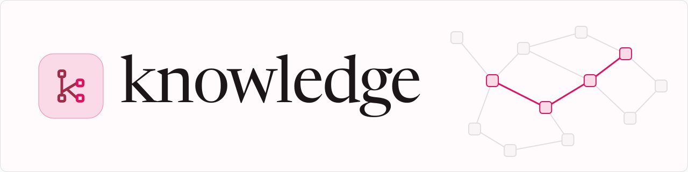
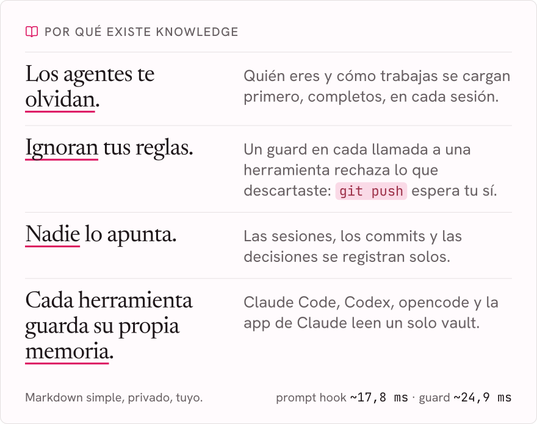

<p align="center">
  <picture>
    <source media="(prefers-color-scheme: dark)" srcset="assets/banner-dark.svg">
    
  </picture>
</p>

<p align="center"><a href="README.md">English</a> | <a href="README.tr.md">Türkçe</a> | <b>Español</b> | <a href="README.pt.md">Português</a> | <a href="README.fr.md">Français</a> | <a href="README.de.md">Deutsch</a></p>

<p align="center">
  <a href="https://github.com/atlasatakahraman/knowledge/stargazers"><picture><source media="(prefers-color-scheme: dark)" srcset="https://raw.githubusercontent.com/atlasatakahraman/knowledge/badges/stars-es-dark.svg"></picture></a>
  <a href="https://github.com/atlasatakahraman/knowledge/tags"><picture><source media="(prefers-color-scheme: dark)" srcset="https://raw.githubusercontent.com/atlasatakahraman/knowledge/badges/latest-es-dark.svg"></picture></a>
</p>
<p align="center">
  <a href="#agentes"><picture><source media="(prefers-color-scheme: dark)" srcset="assets/badges/harnesses-es-dark.svg"></picture></a>
  <a href="#requisitos"><picture><source media="(prefers-color-scheme: dark)" srcset="assets/badges/platforms-es-dark.svg"></picture></a>
</p>
<p align="center">
  <a href="docs/benchmark.md"><picture><source media="(prefers-color-scheme: dark)" srcset="assets/badges/prompt-hook-es-dark.svg"></picture></a>
  <a href="docs/benchmark.md"><picture><source media="(prefers-color-scheme: dark)" srcset="assets/badges/guard-es-dark.svg"></picture></a>
  <a href="docs/benchmark.md"><picture><source media="(prefers-color-scheme: dark)" srcset="assets/badges/tokens-es-dark.svg"></picture></a>
  <a href="docs/benchmark.md"><picture><source media="(prefers-color-scheme: dark)" srcset="assets/badges/find-es-dark.svg"></picture></a>
</p>

<p align="center"><b>Conocimiento que crece contigo y con tus agentes.</b><br>
Memoria y reglas para agentes de programación. Quién eres, qué descartaste y qué
decidiste, cargado en cada sesión de cada agente que usas.</p>

<picture>
  <source media="(prefers-color-scheme: dark)" srcset="assets/hero-es-dark.svg">
  
</picture>

## Inicio rápido

### Que lo haga tu agente

Pega esto en Claude Code, Codex u opencode:

```text
Install knowledge for me from https://github.com/atlasatakahraman/knowledge.
Follow its AGENTS.md, show me each step's output, and ask before anything you write.
```

[AGENTS.md](AGENTS.md) lo guía por los mismos pasos que se describen abajo, con la salida que cada
uno debe imprimir. Te muestra el plan de instalación, lo aplica solo con tu sí y luego te pregunta
qué paquetes de reglas quieres.

### Requisitos

`git`, `gitleaks`, Claude Code (`claude`) y la toolchain de Rust (`rustup`; `rust-toolchain.toml`
fija la 1.100.0 y rustup la descarga en la primera compilación). Aún no se publican archivos de
release, así que el binario se compila desde el código fuente, en dos o tres minutos.

### A mano

```bash
git clone https://github.com/atlasatakahraman/knowledge ~/dev/knowledge
cargo install --path ~/dev/knowledge --locked
knowledge setup --plan
knowledge setup --apply <id>      # the id is the plan's last line
```

`--plan` no escribe nada. Lista cada archivo que crearía o cambiaría, primero para Claude Code y
luego para cada otro agente que encuentre, y termina con el id del plan. `--apply <id>` se niega si
algo cambió desde entonces; si no, escribe exactamente ese plan. Un vault nuevo se crea en
`~/knowledge`; también se puede adoptar una carpeta existente. Opciones, Windows y cada paso a mano:
[docs/install.md](docs/install.md).

### Después de un vault nuevo

Hazlo tuyo. Rellena `00-Meta/Identity.md` y `00-Meta/Hard-Rules.md`
(`grep -rn "FILL:" ~/knowledge/00-Meta` lista lo que falta) y sustituye las preguntas de
`00-Meta/retrieval-cases.json` por las que el vault debe responder siempre. `knowledge doctor
--repair --pretty` construye el primer índice, y `knowledge rules list` con `rules enable <pack>`
activa los paquetes de reglas que quieras.

## Una sesión, en la práctica

Salida real del fixture público que usa [docs/benchmark.md](docs/benchmark.md): la documentación de
este repositorio como vault. Las rutas están acortadas y los fragmentos largos, recortados.

**Escribes un prompt.** El prompt hook añade las notas que lo responden antes de que el agente lea
una sola palabra:

```text
> update knowledge to the newest release

Relevant notes from the knowledge vault (~/knowledge):
- **update** — $ knowledge update --plan  knowledge 0.12.0, x86_64-pc-windows-msvc …
- **verify** — …from `knowledge setup --plan`, or update.md over an older version. How a release …
- **release** — …A release is eight archives (build.yml's targets), one SHA256SUMS over them, …
```

**El agente busca algo** con una sola llamada, desde cualquier carpeta, en lugar de grep y un montón
de lecturas:

```text
$ knowledge find "check the signature on a downloaded release"
release — ~/knowledge/20-Knowledge/knowledge/release.md
  …download v0.13.0 -R atlasatakahraman/knowledge -p SHA256SUMS … 5. Check the signature…
verify — ~/knowledge/20-Knowledge/knowledge/verify.md
  …Three checks, each answering a different question: | The signature over SHA256SUMS | …
```

**El agente intenta algo que descartaste.** El guard responde antes de que la herramienta se ejecute:

```text
$ git reset --hard HEAD~3
ask: push-destructive-git (nothing-is-committed-until-i-give-an-explicit-go): each push needs
its own yes, and destructive git is the owner's call (Hard-Rules § Git)
```

**La sesión termina.** Su nota diaria, sus commits y las decisiones que tomó se escriben en el
vault y se envían a tu propio remoto para tus otras máquinas.

## Agentes

"Verificado" significa una sesión en vivo sobre una instalación real (Windows, 2026-11-23); las
mismas comprobaciones en Arch esperan su turno. El código de cada adaptador también se ejecuta en
CI sobre instalaciones de prueba.

| Agente | Qué recibe | Aplicación | Estado |
|---|---|---|---|
| Claude Code | Identity y Hard-Rules importados enteros en `~/.claude/CLAUDE.md`; los hooks del plugin en nueve eventos; `/knowledge`; el mapa de código (`knowledge find --code`, `graph --code`) | El guard en `PreToolUse` (llamadas de shell, edición y MCP) con deny y ask; la restauración al inicio de sesión; el backstop de pre-commit | Verificado |
| Codex CLI | El bloque escrito entero en `~/.codex/AGENTS.md`; los hooks del plugin en ocho eventos, fijados a la versión del binario; `/knowledge` vía `~/.agents/skills`; `knowledge` por MCP, mapa de código incluido | El guard en `PreToolUse` (`Bash`, `apply_patch`, llamadas MCP), solo deny: una regla ask es un deny, porque Codex no puede preguntar; los hooks solo se ejecutan cuando los revisas; restauración y backstop | Verificado |
| opencode | El bloque en `~/.config/opencode/AGENTS.md`; el plugin shim en ocho eventos, siete de los cuales ejecutan el binario; `/knowledge` | El guard en `execute.before` (`shell`, `edit`, `write`, `patch`), solo deny; restauración y backstop | Verificado; sus eventos de compactación y borrado de sesión solo se ejecutan en la app interactiva y no se alcanzaron |
| App de escritorio de Claude, Chat | `knowledge mcp`: `find`, `graph`, `read` y `note`, que pregunta antes de escribir | Ninguna: sin shell ni hooks, no hay llamada nuestra que vigilar | Verificado |
| Codex de la app de ChatGPT | Los hooks del plugin de Codex, una vez aceptados en la CLI | Como Codex; los hooks aún no aceptados se omiten en silencio | Compilado, no verificado |
| Cualquier otro (`generic`) | El bloque en un archivo que tú indicas, `knowledge find` y `graph`, y `knowledge note` para escribir de vuelta | Ninguna en ejecución: las reglas son solo texto. El backstop de pre-commit sigue corriendo en cada clon que configuró `setup` | Compilado, no verificado |

Cómo se añade un agente: [docs/architecture.md](docs/architecture.md#harnesses).

## Cómo funciona

Un único binario nativo, `knowledge`, responde a cada hook. Ningún hook arranca un runtime de
JavaScript, y el índice del vault es un solo archivo SQLite por máquina.

- **El inicio de sesión** importa enteros quién eres y tus reglas, hace pull del vault y restaura
  cualquier regla cambiada sin un relock.
- **Cada prompt** recibe los nombres de las notas que lo responden, con su mejor pasaje (~17,8 ms).
- **Cada llamada a una herramienta** pasa primero por el guard (~24,9 ms): `deny` o `ask` con el id
  de la regla.
- **El fin de sesión** escribe la nota diaria, las notas de commit y las decisiones, y luego envía
  solo esos registros.
- **Bajo demanda:** `knowledge find` (notas, documentación de repos, salida capturada),
  `knowledge graph` (cómo se conectan las notas), `find --code` y `graph --code` (dónde vive un
  símbolo y qué lo usa), y `keep` y `fetch` (salidas largas y páginas web, guardadas y buscables).
- **`knowledge doctor`** lo revisa todo de una vez: el índice, las preguntas que el vault debe
  responder siempre, los enlaces, los registros, las reglas. Silencio al iniciar sesión significa
  que todo está sano.

Qué escribe cada hook y cuándo: `template/00-Meta/Hook-Lifecycle.md`. Cada verbo, con salida real:
[docs/verbs.md](docs/verbs.md).

### Las reglas y el guard

`00-Meta/Hard-Rules.md` sigue siendo una sola nota, cargada entera. Cada sección `##` es un paquete.
Cada regla es una viñeta que empieza con una línea en negrita, y el slug de esa línea es el id de la
regla. `00-Meta/rules.lock` (JSON, versionado) guarda lo que el texto no puede: el paquete de cada
regla, su tipo, sus puntos de aplicación y el hash de su texto completo, además de los guards. No se
añade nada al texto que se carga. Editas la nota y luego ejecutas `knowledge rules lock`, o dejas que
lo ejecute el agente: el guard te pregunta primero.

- **El guard** (`hook pre-tool`, en el evento previo a cada herramienta de cada agente, para
  llamadas de shell, edición y MCP) divide una línea de shell en segmentos y palabras, y responde
  `deny` o `ask` con el id de la regla. Solo lee `rules.lock`. No imprime nada cuando permite, y si
  el lock falta o está roto, permite con una línea en stderr.
- **El backstop** es `githooks/pre-commit`. Ejecuta el hook propio del repo, gitleaks y luego
  `rules check --staged`, que rechaza un commit que contenga los nombres que un guard vigila
  (`package-lock.json`) o un Hard-Rules que no coincida con el lock. `setup` lo instala en el vault,
  en el skeleton y en cada checkout que nombra una página de `10-Repos`.
- **La restauración.** Cada inicio de sesión ejecuta `rules check --restore`. Una regla que difiere
  del lock vuelve desde `HEAD` cuando `HEAD` coincide con el lock, y una línea lo dice. Si no, el
  doctor da FAIL hasta que hagas relock o reviertas.

**Lo que no puede impedir.** Un agente que ejecuta código como tú puede cambiar cualquier archivo
que tú puedas cambiar. El guard te consulta las formas directas: un Edit, `sed -i`, una redirección,
`Set-Content`. No puede juzgar un envoltorio (el `-e` de un intérprete, una sustitución, un escape).
Ese caso se detecta después, con la restauración del siguiente inicio de sesión y el doctor.

## Por qué no un archivo de memoria

Un archivo de memoria funciona hasta que el agente olvida leerlo, o lee la copia que pertenece a
otra carpeta: la propia memoria de Claude Code se reparte por directorio de trabajo. Cada agente
guarda la suya, así que lo que aprendió Codex nunca llega a Claude Code. Y una regla escrita en un
archivo es un consejo; nada detiene la llamada que la rompe.

Aquí un hook se ejecuta tanto si el agente se acuerda como si no. Tus reglas se cargan enteras en
cada sesión de cada agente, un guard hace cumplir las que un comando puede romper, y los registros
los escriben los hooks, no la buena voluntad del agente. Cada parte tiene un vigilante, porque una
cadena así falla quedándose en silencio: `template/00-Meta/Why-This-Exists.md`.

## Tus datos y la red

- **El vault es Markdown simple en tu propio repositorio git.** No se guarda nada en ningún otro
  sitio salvo los índices por máquina junto a tu config, que se reconstruyen desde las notas en
  aproximadamente un segundo.
- **Sin telemetría.** Ningún hook llama a un servidor nuestro, y nada busca actualizaciones por su
  cuenta.
- **Lo que toca la red:** `git pull` y el envío de los registros, al remoto de tu propio vault;
  `fetch`, cuando tú o el agente lo ejecutan; `update --plan`, cuando tú lo ejecutas; el flush y el
  compile headless, a través de la propia CLI y cuenta de tu agente.
- **Nunca se leen:** las credenciales de los agentes. El motor ejecuta la CLI del agente y deja que
  inicie sesión por sí misma.

La lista completa y lo que `fetch` rechaza: [docs/security.md](docs/security.md).

## Obsidian es opcional

El vault es una carpeta de archivos Markdown con `[[wikilinks]]`, y cada verbo funciona sobre ella
sin Obsidian. Ábrelo en Obsidian si quieres la vista de grafo: `setup` colorea sus grupos por tipo
de nota.

## Documentación

En inglés: [Instalación](docs/install.md) · [verificar una release](docs/verify.md) ·
[actualizar](docs/update.md) · [desinstalar](docs/remove.md) · [cada verbo](docs/verbs.md) ·
[seguridad](docs/security.md) · [solución de problemas](docs/troubleshooting.md) ·
[benchmark](docs/benchmark.md) · [arquitectura](docs/architecture.md) · [release](docs/release.md),
para el mantenedor.

## Contribuir

Cómo está organizado el motor, sus crates, la config por máquina, la sincronización y la CI:
[docs/architecture.md](docs/architecture.md). Cómo trabajar en este repositorio:
[AGENTS.md](AGENTS.md), segunda parte.

## Herramientas de terceros

Se instalan desde sus propios orígenes, nunca se incluyen aquí:

- [gitleaks](https://github.com/gitleaks/gitleaks) - MIT. Escanea cada commit
  (`githooks/pre-commit`) y los registros antes de enviarlos. Sin él no se hace ningún commit.

Las fuentes dibujadas en las imágenes (Newsreader, Hanken Grotesk, JetBrains Mono) son SIL OFL 1.1,
y los iconos son [Lucide](https://lucide.dev) (ISC).

## Licencia

MIT. Consulta `LICENSE`. Las herramientas de terceros de arriba conservan sus propias licencias.

Las versiones hasta la 0.4.0 se publicaron bajo GPL-3.0-only y siguen disponibles bajo ella; desde la
0.5.0 el skeleton no toma ninguna dependencia GPL, así que la concesión MIT queda entera.

---

Esta página es una traducción de [README.md](README.md); si difieren, vale la versión en inglés.
