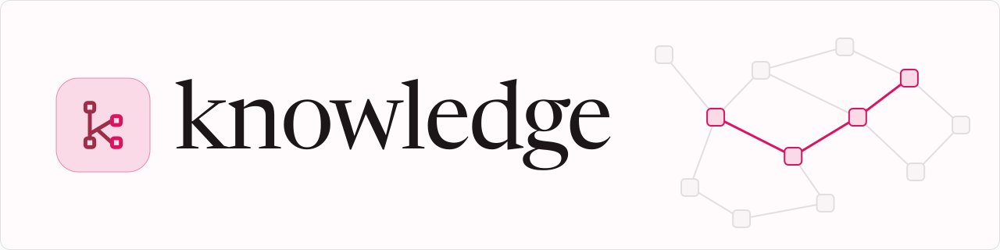
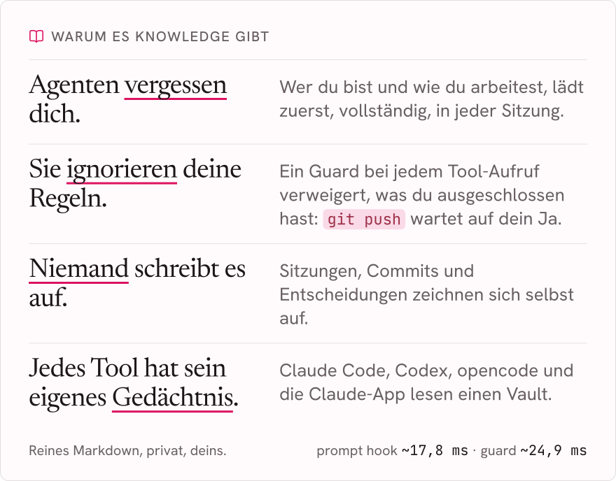

<p align="center">
  <picture>
    <source media="(prefers-color-scheme: dark)" srcset="../assets/banner-dark.svg">
    
  </picture>
</p>

<p align="center"><a href="../README.md">English</a> | <a href="README.tr.md">Türkçe</a> | <a href="README.es.md">Español</a> | <a href="README.pt.md">Português</a> | <a href="README.fr.md">Français</a> | <b>Deutsch</b></p>

<p align="center">
  <a href="https://github.com/atlasatakahraman/knowledge/stargazers"><picture><source media="(prefers-color-scheme: dark)" srcset="https://raw.githubusercontent.com/atlasatakahraman/knowledge/badges/stars-de-dark.svg"></picture></a>
  <a href="https://github.com/atlasatakahraman/knowledge/tags"><picture><source media="(prefers-color-scheme: dark)" srcset="https://raw.githubusercontent.com/atlasatakahraman/knowledge/badges/latest-de-dark.svg"></picture></a>
</p>
<p align="center">
  <a href="#agenten"><picture><source media="(prefers-color-scheme: dark)" srcset="../assets/badges/harnesses-de-dark.svg"></picture></a>
  <a href="#voraussetzungen"><picture><source media="(prefers-color-scheme: dark)" srcset="../assets/badges/platforms-de-dark.svg"></picture></a>
</p>
<p align="center">
  <a href="../docs/benchmark.md"><picture><source media="(prefers-color-scheme: dark)" srcset="../assets/badges/prompt-hook-de-dark.svg"></picture></a>
  <a href="../docs/benchmark.md"><picture><source media="(prefers-color-scheme: dark)" srcset="../assets/badges/guard-de-dark.svg"></picture></a>
  <a href="../docs/benchmark.md"><picture><source media="(prefers-color-scheme: dark)" srcset="../assets/badges/tokens-de-dark.svg"></picture></a>
  <a href="../docs/benchmark.md"><picture><source media="(prefers-color-scheme: dark)" srcset="../assets/badges/find-de-dark.svg"></picture></a>
</p>

<p align="center"><b>Wissen, das mit dir und deinen Agenten wächst.</b><br>
Gedächtnis und Regeln für Coding-Agenten. Wer du bist, was du ausgeschlossen und
was du entschieden hast, geladen in jede Sitzung jedes Agenten, den du nutzt.</p>

<picture>
  <source media="(prefers-color-scheme: dark)" srcset="../assets/hero-de-dark.svg">
  
</picture>

## Schnellstart

### Lass es deinen Agenten machen

Füge das in Claude Code, Codex oder opencode ein:

```text
Install knowledge for me from https://github.com/atlasatakahraman/knowledge.
Follow its AGENTS.md, show me each step's output, and ask before anything you write.
```

[AGENTS.md](../AGENTS.md) führt ihn durch dieselben Schritte wie unten, mit der Ausgabe, die jeder
Schritt zeigen sollte. Er zeigt dir den Setup-Plan, wendet ihn nur mit deinem Ja an und fragt dann,
welche Regelpakete du willst.

### Voraussetzungen

`git`, `gitleaks`, Claude Code (`claude`) und die GitHub CLI (`gh`, für die Build-Provenienz).
Jedes Release hat ein signiertes Archiv pro Plattform, das vor dem Entpacken geprüft wird
([docs/verify.md](../docs/verify.md)). Gibt es keins für deine Plattform, wird das Binary mit der
Rust-Toolchain (`rustup`) aus dem Quellcode gebaut, in zwei bis drei Minuten.

### Von Hand

```bash
git -c advice.detachedHead=false clone --branch v0.13.0 https://github.com/atlasatakahraman/knowledge ~/dev/knowledge
# the binary: your platform's release archive, verified, into ~/.local/bin (docs/install.md),
# or from source: cargo install --path ~/dev/knowledge --locked
knowledge setup --plan
knowledge setup --apply <id>      # the id is the plan's last line
```

`--plan` schreibt nichts. Es listet jede Datei auf, die es anlegen oder ändern würde, zuerst für
Claude Code und dann für jeden anderen Agenten, den es findet, und endet mit der ID des Plans.
`--apply <id>` verweigert, wenn sich seitdem etwas bewegt hat, und schreibt sonst genau diesen Plan.
Ein neuer Vault landet in `~/knowledge`; stattdessen kann auch ein vorhandener Ordner übernommen
werden. Optionen, Windows und jeder Schritt von Hand: [docs/install.md](../docs/install.md).

### Nach einem neuen Vault

Mach ihn zu deinem. Fülle `00-Meta/Identity.md` und `00-Meta/Hard-Rules.md` aus
(`grep -rn "FILL:" ~/knowledge/00-Meta` listet, was noch fehlt), und ersetze die Fragen in
`00-Meta/retrieval-cases.json` durch solche, die der Vault immer beantworten muss. `knowledge doctor
--repair --pretty` baut den ersten Index, und `knowledge rules list` mit `rules enable <pack>`
schaltet die Regelpakete ein, die du willst.

## Eine Sitzung in der Praxis

Echte Ausgabe aus der öffentlichen Fixture, die [docs/benchmark.md](../docs/benchmark.md) nutzt: die
Dokumentation dieses Repositorys als Vault. Pfade sind gekürzt und lange Ausschnitte abgeschnitten.

**Du tippst einen Prompt.** Der Prompt-Hook fügt die Notizen hinzu, die ihn beantworten, bevor der
Agent ein Wort liest:

```text
> update knowledge to the newest release

Relevant notes from the knowledge vault (~/knowledge):
- **update** — $ knowledge update --plan  knowledge 0.13.0, x86_64-pc-windows-msvc …
- **verify** — …from `knowledge setup --plan`, or update.md over an older version. How a release …
- **release** — …A release is eight archives (build.yml's targets), one SHA256SUMS over them, …
```

**Der Agent schlägt etwas nach**, mit einem einzigen Aufruf aus jedem Ordner, statt mit grep und
einem Stapel Lesezugriffe:

```text
$ knowledge find "check the signature on a downloaded release"
release — ~/knowledge/20-Knowledge/knowledge/release.md
  …download v0.13.0 -R atlasatakahraman/knowledge -p SHA256SUMS … 5. Check the signature…
verify — ~/knowledge/20-Knowledge/knowledge/verify.md
  …Three checks, each answering a different question: | The signature over SHA256SUMS | …
```

**Der Agent versucht etwas, das du ausgeschlossen hast.** Der Guard antwortet, bevor das Tool läuft:

```text
$ git reset --hard HEAD~3
ask: push-destructive-git (nothing-is-committed-until-i-give-an-explicit-go): each push needs
its own yes, and destructive git is the owner's call (Hard-Rules § Git)
```

**Die Sitzung endet.** Ihre Tagesnotiz, ihre Commits und die getroffenen Entscheidungen werden in
den Vault geschrieben und für deine anderen Rechner zu deinem eigenen Remote gepusht.

## Agenten

„Verifiziert“ heißt eine Live-Sitzung auf einer echten Installation (Windows, 2026-11-23); dieselben
Prüfungen auf Arch warten auf ihren Durchgang. Der Code jedes Adapters läuft außerdem in der CI auf
Test-Installationen.

| Agent | Was er bekommt | Durchsetzung | Status |
|---|---|---|---|
| Claude Code | Identity und Hard-Rules vollständig in `~/.claude/CLAUDE.md` importiert; die Hooks des Plugins auf neun Events; `/knowledge`; die Code-Karte (`knowledge find --code`, `graph --code`) | Der Guard auf `PreToolUse` (Shell-, Edit- und MCP-Aufrufe) mit deny und ask; die Wiederherstellung beim Sitzungsstart; der Pre-Commit-Backstop | Verifiziert |
| Codex CLI | Der Block vollständig in `~/.codex/AGENTS.md` geschrieben; die Hooks des Plugins auf acht Events, auf die Version des Binarys gepinnt; `/knowledge` über `~/.agents/skills`; `knowledge` über MCP, inklusive Code-Karte | Der Guard auf `PreToolUse` (`Bash`, `apply_patch`, MCP-Aufrufe), nur deny: Eine ask-Regel ist ein deny, da Codex nicht fragen kann; Hooks laufen erst, wenn du sie geprüft hast; Wiederherstellung und Backstop | Verifiziert |
| opencode | Der Block in `~/.config/opencode/AGENTS.md`; das Shim-Plugin auf acht Events, von denen sieben das Binary starten; `/knowledge` | Der Guard in `execute.before` (`shell`, `edit`, `write`, `patch`), nur deny; Wiederherstellung und Backstop | Verifiziert; seine Compaction- und Session-Delete-Events laufen nur in der interaktiven App und wurden nicht erreicht |
| Claude-Desktop-App, Chat | `knowledge mcp`: `find`, `graph`, `read` und `note`, das vor dem Schreiben fragt | Keine: keine Shell und keine Hooks, also kein Aufruf von uns zu bewachen | Verifiziert |
| Codex in der ChatGPT-App | Die Hooks des Codex-Plugins, sobald sie in der CLI als vertrauenswürdig bestätigt sind | Wie Codex; noch nicht bestätigte Hooks werden stillschweigend übersprungen | Gebaut, nicht verifiziert |
| Jeder andere (`generic`) | Der Block in einer Datei, die du angibst, `knowledge find` und `graph`, und `knowledge note` zum Zurückschreiben | Zur Laufzeit keine: Die Regeln sind nur Text. Der Pre-Commit-Backstop läuft trotzdem in jedem Clone, den `setup` eingerichtet hat | Gebaut, nicht verifiziert |

Wie ein Agent hinzukommt: [docs/architecture.md](../docs/architecture.md#harnesses).

## Wie es funktioniert

Ein einziges natives Binary, `knowledge`, beantwortet jeden Hook. Kein Hook startet eine
JavaScript-Runtime, und der Index des Vaults ist eine SQLite-Datei pro Rechner.

- **Der Sitzungsstart** importiert vollständig, wer du bist, und deine Regeln, pullt den Vault und
  stellt jede Regel wieder her, die ohne Relock geändert wurde.
- **Jeder Prompt** bekommt die Namen der Notizen, die ihn beantworten, mit ihrer besten Passage
  (~17,8 ms).
- **Jeder Tool-Aufruf** passiert zuerst den Guard (~24,9 ms): `deny` oder `ask` mit der ID der Regel.
- **Das Sitzungsende** schreibt die Tagesnotiz, die Commit-Notizen und die Entscheidungen und pusht
  dann nur diese Einträge.
- **Auf Abruf:** `knowledge find` (Notizen, Repo-Dokumentation, gespeicherte Ausgaben),
  `knowledge graph` (wie Notizen zusammenhängen), `find --code` und `graph --code` (wo ein Symbol
  liegt und was es nutzt), und `keep` und `fetch` (lange Ausgaben und Webseiten, gespeichert und
  durchsuchbar).
- **`knowledge doctor`** prüft alles in einem Lauf: den Index, die Fragen, die der Vault immer
  beantworten muss, Links, die Einträge, die Regeln. Stille beim Sitzungsstart heißt: alles gesund.

Was jeder Hook schreibt und wann: `template/00-Meta/Hook-Lifecycle.md`. Jedes Verb, mit echter
Ausgabe: [docs/verbs.md](../docs/verbs.md).

### Regeln und der Guard

`00-Meta/Hard-Rules.md` bleibt eine Notiz und wird vollständig geladen. Jeder `##`-Abschnitt ist ein
Paket. Jede Regel ist ein Aufzählungspunkt, der mit einer fetten Zeile beginnt, und der Slug dieser
Zeile ist die ID der Regel. `00-Meta/rules.lock` (JSON, versioniert) hält, was der Text nicht halten
kann: das Paket jeder Regel, ihre Art, ihre Durchsetzungspunkte und den Hash ihres ganzen Textes,
dazu die Guards. Dem geladenen Text wird nichts hinzugefügt. Du bearbeitest die Notiz und führst
dann `knowledge rules lock` aus oder lässt es den Agenten ausführen: Der Guard fragt dich zuerst.

- **Der Guard** (`hook pre-tool`, auf dem Pre-Tool-Event jedes Agenten für Shell-, Edit- und
  MCP-Aufrufe) zerlegt eine Shell-Zeile in Segmente und Wörter und antwortet `deny` oder `ask` mit
  der ID der Regel. Er liest nur `rules.lock`. Wenn er erlaubt, gibt er nichts aus, und bei einem
  fehlenden oder kaputten Lock erlaubt er mit einer Zeile auf stderr.
- **Der Backstop** ist `githooks/pre-commit`. Er führt den eigenen Hook des Repos aus, gitleaks und
  dann `rules check --staged`, das einen Commit scheitern lässt, der die Namen enthält, die ein Guard
  bewacht (`package-lock.json`), oder ein Hard-Rules, das nicht zum Lock passt. `setup` richtet ihn
  im Vault, im Skeleton und in jedem Checkout ein, den eine `10-Repos`-Seite nennt.
- **Die Wiederherstellung.** Jeder Sitzungsstart führt `rules check --restore` aus. Eine Regel, die
  vom Lock abweicht, kommt aus `HEAD` zurück, wenn `HEAD` zum Lock passt, und eine Zeile sagt das.
  Sonst meldet der Doctor FAIL, bis du neu lockst oder zurücksetzt.

**Was er nicht verhindern kann.** Ein Agent, der Code als du ausführt, kann jede Datei ändern, die
du ändern kannst. Der Guard legt dir die direkten Formen vor: ein Edit, `sed -i`, eine Umleitung,
`Set-Content`. Einen Wrapper (das `-e` eines Interpreters, eine Substitution, ein Escape) kann er
nicht beurteilen. Dieser Fall wird hinterher erkannt, durch die Wiederherstellung beim nächsten
Sitzungsstart und den Doctor.

## Warum keine Memory-Datei

Eine Memory-Datei funktioniert, bis der Agent vergisst, sie zu lesen, oder die Kopie liest, die zu
einem anderen Ordner gehört: Das eigene Gedächtnis von Claude Code ist nach Arbeitsverzeichnis
aufgeteilt. Jeder Agent führt sein eigenes, also erreicht, was Codex gelernt hat, nie Claude Code.
Und eine Regel in einer Datei ist ein Ratschlag; nichts stoppt den Tool-Aufruf, der sie bricht.

Hier läuft ein Hook, ob der Agent daran denkt oder nicht. Deine Regeln laden vollständig in jeder
Sitzung jedes Agenten, ein Guard setzt die durch, die ein Befehl brechen kann, und die Einträge
schreiben die Hooks, nicht der gute Wille des Agenten. Jeder Teil hat einen Wächter, denn eine
Pipeline wie diese versagt, indem sie verstummt: `template/00-Meta/Why-This-Exists.md`.

## Deine Daten und das Netz

- **Der Vault ist reines Markdown in deinem eigenen git-Repository.** Nichts wird anderswo
  gespeichert außer den Indizes pro Rechner neben deiner Config, die sich in etwa einer Sekunde aus
  den Notizen neu aufbauen.
- **Keine Telemetrie.** Kein Hook ruft einen Server von uns an, und nichts sucht von selbst nach
  Updates.
- **Was das Netz berührt:** `git pull` und der Push der Einträge, zum Remote deines eigenen Vaults;
  `fetch`, wenn du oder der Agent es ausführt; `update --plan`, wenn du es ausführst; Flush und
  Compile ohne Oberfläche, über die eigene CLI und das Konto deines Agenten.
- **Nie gelesen:** die Zugangsdaten der Agenten. Die Engine führt die CLI des Agenten aus und lässt
  sie sich selbst anmelden.

Die vollständige Liste und was `fetch` ablehnt: [docs/security.md](../docs/security.md).

## Obsidian ist optional

Der Vault ist ein Ordner mit Markdown-Dateien und `[[wikilinks]]`, und jedes Verb funktioniert darauf
ohne Obsidian. Öffne ihn in Obsidian, wenn du die Graph-Ansicht willst: `setup` färbt ihre Gruppen
nach Notiztyp.

## Dokumentation

Auf Englisch: [Installation](../docs/install.md) · [ein Release prüfen](../docs/verify.md) ·
[aktualisieren](../docs/update.md) · [entfernen](../docs/remove.md) · [jedes Verb](../docs/verbs.md) ·
[Sicherheit](../docs/security.md) · [Fehlerbehebung](../docs/troubleshooting.md) ·
[Benchmark](../docs/benchmark.md) · [Architektur](../docs/architecture.md) · [Release](../docs/release.md),
für den Maintainer.

## Mitmachen

Wie die Engine aufgebaut ist, ihre Crates, die Config pro Rechner, Sync und CI:
[docs/architecture.md](../docs/architecture.md). Wie man an diesem Repository arbeitet:
[AGENTS.md](../AGENTS.md), zweiter Teil.

## Tools von Dritten

Aus ihren eigenen Quellen installiert, nie hier mitgeliefert:

- [gitleaks](https://github.com/gitleaks/gitleaks) - MIT. Prüft jeden Commit
  (`githooks/pre-commit`) und die Einträge, bevor sie gepusht werden. Ohne gitleaks wird nichts
  committet.

Die in die Bilder gezeichneten Schriften (Newsreader, Hanken Grotesk, JetBrains Mono) stehen unter
SIL OFL 1.1, die Icons sind [Lucide](https://lucide.dev) (ISC).

## Lizenz

MIT. Siehe `LICENSE`. Die Tools von Dritten oben behalten ihre eigenen Lizenzen.

Versionen bis 0.4.0 wurden unter GPL-3.0-only veröffentlicht und bleiben darunter verfügbar; ab
0.5.0 nimmt das Skeleton keine GPL-Abhängigkeit auf, damit die MIT-Lizenz vollständig bleibt.

---

Diese Seite ist eine Übersetzung von [README.md](../README.md); bei Abweichungen gilt die englische
Fassung.
