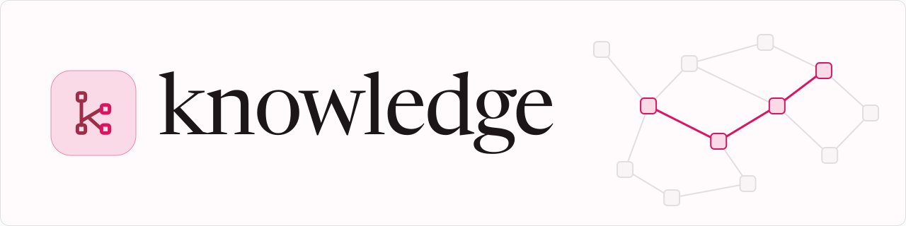
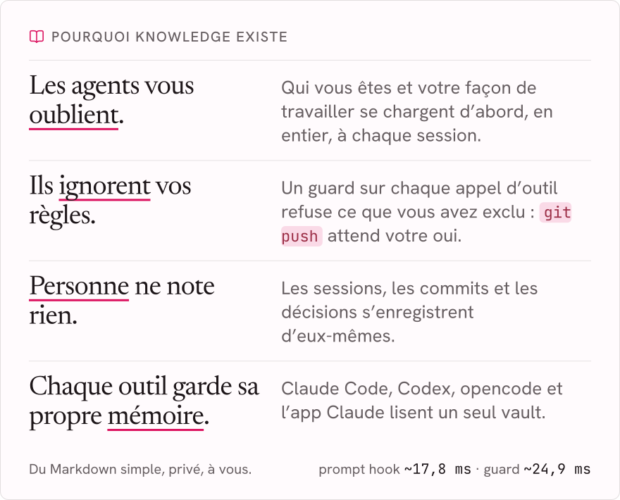

<p align="center">
  <picture>
    <source media="(prefers-color-scheme: dark)" srcset="../assets/banner-dark.svg">
    
  </picture>
</p>

<p align="center"><a href="../README.md">English</a> | <a href="README.tr.md">Türkçe</a> | <a href="README.es.md">Español</a> | <a href="README.pt.md">Português</a> | <b>Français</b> | <a href="README.de.md">Deutsch</a></p>

<p align="center">
  <a href="https://github.com/atlasatakahraman/knowledge/stargazers"><picture><source media="(prefers-color-scheme: dark)" srcset="https://raw.githubusercontent.com/atlasatakahraman/knowledge/badges/stars-fr-dark.svg"></picture></a>
  <a href="https://github.com/atlasatakahraman/knowledge/tags"><picture><source media="(prefers-color-scheme: dark)" srcset="https://raw.githubusercontent.com/atlasatakahraman/knowledge/badges/latest-fr-dark.svg"></picture></a>
</p>
<p align="center">
  <a href="#agents"><picture><source media="(prefers-color-scheme: dark)" srcset="../assets/badges/harnesses-fr-dark.svg"></picture></a>
  <a href="#prérequis"><picture><source media="(prefers-color-scheme: dark)" srcset="../assets/badges/platforms-fr-dark.svg"></picture></a>
</p>
<p align="center">
  <a href="../docs/benchmark.md"><picture><source media="(prefers-color-scheme: dark)" srcset="../assets/badges/prompt-hook-fr-dark.svg"></picture></a>
  <a href="../docs/benchmark.md"><picture><source media="(prefers-color-scheme: dark)" srcset="../assets/badges/guard-fr-dark.svg"></picture></a>
  <a href="../docs/benchmark.md"><picture><source media="(prefers-color-scheme: dark)" srcset="../assets/badges/tokens-fr-dark.svg"></picture></a>
  <a href="../docs/benchmark.md"><picture><source media="(prefers-color-scheme: dark)" srcset="../assets/badges/find-fr-dark.svg"></picture></a>
</p>

<p align="center"><b>Un savoir qui grandit avec vous et vos agents.</b><br>
Mémoire et règles pour les agents de code. Qui vous êtes, ce que vous avez exclu et
ce que vous avez décidé, chargés dans chaque session de chaque agent que vous utilisez.</p>

<picture>
  <source media="(prefers-color-scheme: dark)" srcset="../assets/hero-fr-dark.svg">
  
</picture>

## Démarrage rapide

### Laissez votre agent s’en charger

Collez ceci dans Claude Code, Codex ou opencode :

```text
Install knowledge for me from https://github.com/atlasatakahraman/knowledge.
Follow its AGENTS.md, show me each step's output, and ask before anything you write.
```

[AGENTS.md](../AGENTS.md) lui fait suivre les mêmes étapes que ci-dessous, avec la sortie que chacune
doit afficher. Il vous montre le plan d’installation, ne l’applique qu’avec votre oui, puis vous
demande quels paquets de règles vous voulez, remplit avec vous, une question à la fois, qui vous
êtes et vos règles, et vous propose un dépôt GitHub privé pour le vault.

### Prérequis

`git`, `gitleaks`, Claude Code (`claude`) et la CLI GitHub (`gh`, pour la provenance du build).
Chaque release a une archive signée par plateforme, vérifiée avant de l’extraire
([docs/verify.md](../docs/verify.md)). S’il n’y en a pas pour votre plateforme, le binaire se
compile depuis les sources avec la toolchain Rust (`rustup`), en deux à trois minutes.

### À la main

```bash
git -c advice.detachedHead=false clone --branch v0.13.2 https://github.com/atlasatakahraman/knowledge ~/dev/knowledge
# the binary: your platform's release archive, verified, into ~/.local/bin (docs/install.md),
# or from source: cargo install --path ~/dev/knowledge --locked
knowledge setup --plan
knowledge setup --apply <id>      # the id is the plan's last line
```

`--plan` n’écrit rien. Il liste chaque fichier qu’il créerait ou modifierait, d’abord pour Claude
Code puis pour chaque autre agent qu’il trouve, et se termine par l’id du plan. `--apply <id>` refuse
si quelque chose a bougé depuis, sinon il écrit exactement ce plan. Un nouveau vault arrive dans
`~/knowledge` ; un dossier existant peut aussi être adopté. Les options, Windows et chaque étape à
la main : [docs/install.md](../docs/install.md).

### Après un nouveau vault

Faites-le vôtre. Remplissez `00-Meta/Identity.md` et `00-Meta/Hard-Rules.md`
(`grep -rn "^<!-- FILL:" ~/knowledge/00-Meta` liste ce qui reste) et remplacez les questions de
`00-Meta/retrieval-cases.json` par celles auxquelles le vault doit toujours répondre. `knowledge
doctor --repair --pretty` construit le premier index, et `knowledge rules list` avec
`rules enable <pack>` active les paquets de règles que vous voulez.

## Une session, en pratique

Sortie réelle de la fixture publique qu’utilise [docs/benchmark.md](../docs/benchmark.md) : la
documentation de ce dépôt comme vault. Les chemins sont raccourcis et les longs extraits coupés.

**Vous tapez un prompt.** Le prompt hook ajoute les notes qui y répondent avant que l’agent ne lise
un mot :

```text
> update knowledge to the newest release

Relevant notes from the knowledge vault (~/knowledge):
- **update** — $ knowledge update --plan  knowledge 0.13.2, x86_64-pc-windows-msvc …
- **verify** — …from `knowledge setup --plan`, or update.md over an older version. How a release …
- **release** — …A release is eight archives (build.yml's targets), one SHA256SUMS over them, …
```

**L’agent cherche quelque chose** en un seul appel, depuis n’importe quel dossier, au lieu de grep
et d’une pile de lectures :

```text
$ knowledge find "check the signature on a downloaded release"
release — ~/knowledge/20-Knowledge/knowledge/release.md
  …download v0.13.2 -R atlasatakahraman/knowledge -p SHA256SUMS … 5. Check the signature…
verify — ~/knowledge/20-Knowledge/knowledge/verify.md
  …Three checks, each answering a different question: | The signature over SHA256SUMS | …
```

**L’agent tente quelque chose que vous avez exclu.** Le guard répond avant que l’outil ne s’exécute :

```text
$ git reset --hard HEAD~3
ask: push-destructive-git (nothing-is-committed-until-i-give-an-explicit-go): each push needs
its own yes, and destructive git is the owner's call (Hard-Rules § Git)
```

**La session se termine.** Sa note du jour, ses commits et les décisions prises sont écrits dans le
vault, puis poussés vers votre propre remote pour vos autres machines.

## Agents

« Vérifié » signifie une session réelle sur une vraie installation (Windows, 2026-11-23) ; les
mêmes vérifications sur Arch attendent leur tour. Le code de chaque adaptateur tourne aussi en CI
sur des installations de test.

| Agent | Ce qu’il reçoit | Application | Statut |
|---|---|---|---|
| Claude Code | Identity et Hard-Rules importés en entier dans `~/.claude/CLAUDE.md` ; les hooks du plugin sur neuf événements ; `/knowledge` ; la carte du code (`knowledge find --code`, `graph --code`) | Le guard sur `PreToolUse` (appels shell, édition et MCP) avec deny et ask ; la restauration au démarrage de session ; le backstop pre-commit | Vérifié |
| Codex CLI | Le bloc écrit en entier dans `~/.codex/AGENTS.md` ; les hooks du plugin sur huit événements, épinglés à la version du binaire ; `/knowledge` via `~/.agents/skills` ; `knowledge` par MCP, carte du code comprise | Le guard sur `PreToolUse` (`Bash`, `apply_patch`, appels MCP), deny seulement : une règle ask devient un deny, car Codex ne peut pas demander ; les hooks ne tournent qu’une fois que vous les avez examinés ; restauration et backstop | Vérifié |
| opencode | Le bloc dans `~/.config/opencode/AGENTS.md` ; le plugin shim sur huit événements, dont sept lancent le binaire ; `/knowledge` | Le guard dans `execute.before` (`shell`, `edit`, `write`, `patch`), deny seulement ; restauration et backstop | Vérifié ; ses événements de compaction et de suppression de session ne tournent que dans l’app interactive et n’ont pas été atteints |
| App de bureau Claude, Chat | `knowledge mcp` : `find`, `graph`, `read`, et `note`, qui demande avant d’écrire | Aucune : ni shell ni hooks, donc aucun appel de notre part à surveiller | Vérifié |
| Codex de l’app ChatGPT | Les hooks du plugin Codex, une fois approuvés dans la CLI | Comme Codex ; les hooks pas encore approuvés sont ignorés en silence | Compilé, non vérifié |
| Tout autre (`generic`) | Le bloc dans un fichier que vous indiquez, `knowledge find` et `graph`, et `knowledge note` pour écrire en retour | Aucune à l’exécution : les règles ne sont que du texte. Le backstop pre-commit tourne quand même dans chaque clone configuré par `setup` | Compilé, non vérifié |

Comment un agent est ajouté : [docs/architecture.md](../docs/architecture.md#harnesses).

## Comment ça marche

Un seul binaire natif, `knowledge`, répond à chaque hook. Aucun hook ne lance de runtime
JavaScript, et l’index du vault est un seul fichier SQLite par machine.

- **Le démarrage de session** importe en entier qui vous êtes et vos règles, fait un pull du vault
  et remet en place toute règle modifiée sans relock.
- **Chaque prompt** reçoit les noms des notes qui y répondent, avec leur meilleur passage (~17,8 ms).
- **Chaque appel d’outil** passe d’abord par le guard (~24,9 ms) : `deny` ou `ask` avec l’id de la
  règle.
- **La fin de session** écrit la note du jour, les notes de commit et les décisions, puis ne pousse
  que ces enregistrements.
- **À la demande :** `knowledge find` (notes, documentation des dépôts, sortie capturée),
  `knowledge graph` (comment les notes se relient), `find --code` et `graph --code` (où vit un
  symbole et ce qui l’utilise), et `keep` et `fetch` (longues sorties et pages web, stockées et
  consultables).
- **`knowledge doctor`** vérifie tout en une fois : l’index, les questions auxquelles le vault doit
  toujours répondre, les liens, les enregistrements, les règles. Le silence au démarrage signifie
  que tout va bien.

Ce que chaque hook écrit et quand : `template/00-Meta/Hook-Lifecycle.md`. Chaque verbe, avec une
sortie réelle : [docs/verbs.md](../docs/verbs.md).

### Les règles et le guard

`00-Meta/Hard-Rules.md` reste une seule note, chargée en entier. Chaque section `##` est un paquet.
Chaque règle est une puce qui commence par une ligne en gras, et le slug de cette ligne est l’id de
la règle. `00-Meta/rules.lock` (JSON, suivi par git) contient ce que le texte ne peut pas porter : le
paquet de chaque règle, son type, ses points d’application et le hash de son texte entier, ainsi que
les guards. Rien n’est ajouté au texte chargé. Vous modifiez la note, puis lancez
`knowledge rules lock`, ou laissez l’agent le lancer : le guard vous demande d’abord.

- **Le guard** (`hook pre-tool`, sur l’événement qui précède chaque outil de chaque agent, pour les
  appels shell, édition et MCP) découpe une ligne de shell en segments et en mots, et répond `deny`
  ou `ask` avec l’id de la règle. Il ne lit que `rules.lock`. Il n’affiche rien quand il autorise, et
  si le lock manque ou est cassé, il autorise avec une ligne sur stderr.
- **Le backstop** est `githooks/pre-commit`. Il lance le hook propre au dépôt, gitleaks, puis
  `rules check --staged`, qui fait échouer un commit contenant les noms qu’un guard surveille
  (`package-lock.json`) ou un Hard-Rules en désaccord avec le lock. `setup` l’installe dans le vault,
  dans le skeleton et dans chaque checkout qu’une page de `10-Repos` nomme.
- **La restauration.** Chaque démarrage de session lance `rules check --restore`. Une règle qui
  diffère du lock revient depuis `HEAD` quand `HEAD` correspond au lock, et une ligne le dit. Sinon,
  le doctor est en FAIL jusqu’à ce que vous fassiez un relock ou un revert.

**Ce qu’il ne peut pas empêcher.** Un agent qui exécute du code en votre nom peut modifier tout
fichier que vous pouvez modifier. Le guard vous soumet les formes directes : un Edit, `sed -i`, une
redirection, `Set-Content`. Il ne peut pas juger un emballage (le `-e` d’un interpréteur, une
substitution, un échappement). Ce cas est rattrapé après coup, par la restauration du démarrage
suivant et par le doctor.

## Pourquoi pas un fichier de mémoire

Un fichier de mémoire marche jusqu’à ce que l’agent oublie de le lire, ou lise la copie qui
appartient à un autre dossier : la mémoire propre de Claude Code est découpée par répertoire de
travail. Chaque agent garde la sienne, donc ce que Codex a appris n’atteint jamais Claude Code. Et
une règle écrite dans un fichier n’est qu’un conseil ; rien n’arrête l’appel qui l’enfreint.

Ici, un hook s’exécute que l’agent s’en souvienne ou non. Vos règles se chargent en entier dans
chaque session de chaque agent, un guard fait respecter celles qu’une commande peut enfreindre, et
les enregistrements sont écrits par les hooks, pas par la bonne volonté de l’agent. Chaque partie a
un veilleur, car une chaîne comme celle-ci tombe en panne en devenant silencieuse :
`template/00-Meta/Why-This-Exists.md`.

## Vos données et le réseau

- **Le vault est du Markdown simple dans votre propre dépôt git.** Rien n’est stocké ailleurs, à part
  les index par machine à côté de votre config, qui se reconstruisent depuis les notes en une
  seconde environ.
- **Aucune télémétrie.** Aucun hook n’appelle un serveur à nous, et rien ne cherche de mises à jour
  de lui-même.
- **Ce qui touche le réseau :** `git pull` et l’envoi des enregistrements, vers le remote de votre
  propre vault ; `fetch`, quand vous ou l’agent le lancez ; `update --plan`, quand vous le lancez ;
  le flush et le compile headless, via la CLI et le compte de votre agent.
- **Jamais lus :** les identifiants des agents. Le moteur lance la CLI de l’agent et la laisse se
  connecter elle-même.

La liste complète, et ce que `fetch` refuse : [docs/security.md](../docs/security.md).

## Obsidian est facultatif

Le vault est un dossier de fichiers Markdown avec des `[[wikilinks]]`, et chaque verbe fonctionne
dessus sans Obsidian. Ouvrez-le dans Obsidian si vous voulez la vue en graphe : `setup` colore ses
groupes par type de note.

## Commandes

Chaque commande est un verbe d'un seul binaire, `knowledge`. `knowledge <verb> --help` affiche
l'usage du verbe, quand l'utiliser et pourquoi, et n'exécute rien. Chaque flag, avec une sortie
réelle : [docs/verbs.md](../docs/verbs.md).

| Commande | Utilisez-la quand | Pourquoi |
|---|---|---|
| `find <query>` | vous voulez ce que le vault dit de X et les MOC n'ont pas répondu ; `--captures`, `--repo` et `--code` cherchent dans les sorties gardées, les docs des repos et les symboles | un appel renvoie la note et le passage trouvé, au lieu de fichiers lus dans le contexte |
| `graph <note> [<note>]` | vous voulez savoir comment deux notes sont liées, ou ce qui utilise un symbole (`--code`) | ~25 ms depuis l'index, aucun fichier n'est lu |
| `keep <label> --q <query>` | la sortie d'une commande dépasse ~2 000 caractères et il vous en faut une partie | seules les sections trouvées entrent dans le contexte ; le reste reste cherchable |
| `fetch <url> --q <query>` | vous lisez une page dont vous avez l'adresse | du Markdown coupé selon votre requête ; les adresses privées sont refusées |
| `code index` · `code duplicate` | vous remettez à niveau toutes les cartes de code, ou cherchez des copies dans un commit de monorepo | des réponses sur les symboles à zéro token ; une copie est repérée avant de devenir deux choses à maintenir |
| `index` | des notes ont changé hors d'une session, ou `find` rate une note que vous savez présente | chaque lecteur utilise cet index ; une ligne périmée répond avec un ancien passage |
| `inject <text>` | un prompt a ramené les mauvaises notes | c'est le chemin même du hook de prompt, lancé à la main |
| `events <transcript>` | vous relisez ce qu'une session passée a décidé | seulement les tours qui comptent, pas un transcript de plusieurs mégaoctets |
| `note log` · `note decision` | votre harness n'exécute pas de hooks, ou la capture a manqué une décision | la même écriture que font les hooks |
| `ledger list` · `ledger promote` | le début de session signale des décisions en attente | une capture brute devient un enregistrement de décision, ou est écartée |
| `doctor` | d'abord, dès que quelque chose semble anormal ; après setup ou une mise à jour | le seul endroit qui dit quelle partie s'est tue |
| `rules lock` · `check` · `guard add` | vous avez modifié Hard-Rules, la vérification des règles échoue, ou une règle doit être imposée | une règle dans un fichier est un conseil ; un guard sur chaque appel d'outil est une contrainte |
| `setup --plan` · `--apply <id>` | une nouvelle machine ou un nouveau harness, une mise à jour, un changement de règles | rien n'est écrit avant que vous ayez lu le plan |
| `update --plan` | vous choisissez de chercher une nouvelle version | pas de télémétrie, pas de mise à jour automatique |
| `config [<key>]` | un script a besoin du chemin du vault, ou un hook utilise le mauvais dossier | une seule source par machine, aucun chemin codé en dur |
| `records` | la vérification `auth` du doctor nomme une exécution échouée ; sinon les hooks la lancent | les enregistrements atteignent votre autre machine ; vos propres commits attendent votre oui |
| `flush` · `compile` | le canari du flush se déclenche, ou un jour a été manqué ; les hooks lancent les deux | une session jamais vidée n'est jamais retenue |
| `post-bash --backfill <since>` | vous avez commité dans un terminal sans agent | le texte « pourquoi » de chaque commit arrive dans le vault |
| `hubs` | une nouvelle note n'est pas encore atteignable depuis `00-MOC-Root` | les hubs sont écrits depuis les dossiers, jamais à la main |
| `usage` | vous voulez ce qu'un mois a coûté, par projet ou par fenêtre de 5 heures | lu dans les transcripts locaux, envoyé nulle part |
| `mcp` | une app parle MCP mais n'exécute pas de hooks ; `setup` l'enregistre | le même index et la même carte de code pour les apps sans shell |
| `hook <event>` | pas à la main : `setup` y relie chaque harness | un binaire exécute chaque harness sur le même vault |
| `--version` | après une installation ou une mise à jour, et dans un rapport de bug | indique si la recherche (SQLite FTS5) fonctionne |

## Documentation

En anglais : [Installation](../docs/install.md) · [vérifier une release](../docs/verify.md) ·
[mettre à jour](../docs/update.md) · [désinstaller](../docs/remove.md) · [chaque verbe](../docs/verbs.md) ·
[sécurité](../docs/security.md) · [dépannage](../docs/troubleshooting.md) ·
[benchmark](../docs/benchmark.md) · [architecture](../docs/architecture.md) · [release](../docs/release.md),
pour le mainteneur.

## Contribuer

Comment le moteur est organisé, ses crates, la config par machine, la synchronisation et la CI :
[docs/architecture.md](../docs/architecture.md). Comment travailler sur ce dépôt :
[AGENTS.md](../AGENTS.md), seconde partie.

## Outils tiers

Installés depuis leurs propres sources, jamais embarqués ici :

- [gitleaks](https://github.com/gitleaks/gitleaks) - MIT. Analyse chaque commit
  (`githooks/pre-commit`) et les enregistrements avant leur envoi. Sans lui, rien n’est commité.

Les polices dessinées dans les images (Newsreader, Hanken Grotesk, JetBrains Mono) sont sous SIL OFL
1.1, et les icônes sont [Lucide](https://lucide.dev) (ISC).

## Licence

MIT. Voir `LICENSE`. Les outils tiers ci-dessus gardent leurs propres licences.

Les versions jusqu’à la 0.4.0 ont été publiées sous GPL-3.0-only et restent disponibles sous elle ;
depuis la 0.5.0, le skeleton ne prend aucune dépendance GPL, donc la concession MIT reste entière.

---

Cette page est une traduction de [README.md](../README.md) ; en cas d’écart, la version anglaise fait foi.
