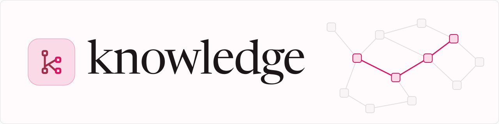
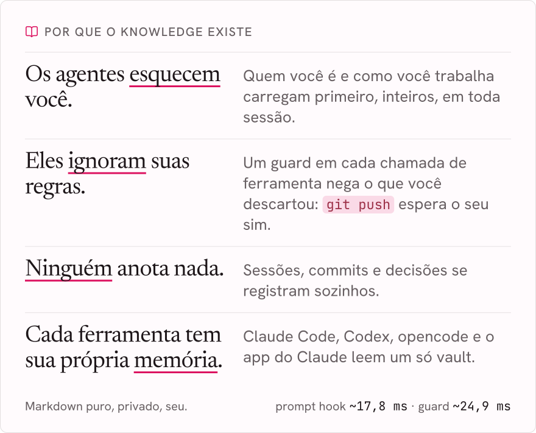

<p align="center">
  <picture>
    <source media="(prefers-color-scheme: dark)" srcset="../assets/banner-dark.svg">
    
  </picture>
</p>

<p align="center"><a href="../README.md">English</a> | <a href="README.tr.md">Türkçe</a> | <a href="README.es.md">Español</a> | <b>Português</b> | <a href="README.fr.md">Français</a> | <a href="README.de.md">Deutsch</a></p>

<p align="center">
  <a href="https://github.com/atlasatakahraman/knowledge/stargazers"><picture><source media="(prefers-color-scheme: dark)" srcset="https://raw.githubusercontent.com/atlasatakahraman/knowledge/badges/stars-pt-dark.svg"></picture></a>
  <a href="https://github.com/atlasatakahraman/knowledge/tags"><picture><source media="(prefers-color-scheme: dark)" srcset="https://raw.githubusercontent.com/atlasatakahraman/knowledge/badges/latest-pt-dark.svg"></picture></a>
</p>
<p align="center">
  <a href="#agentes"><picture><source media="(prefers-color-scheme: dark)" srcset="../assets/badges/harnesses-pt-dark.svg"></picture></a>
  <a href="#requisitos"><picture><source media="(prefers-color-scheme: dark)" srcset="../assets/badges/platforms-pt-dark.svg"></picture></a>
</p>
<p align="center">
  <a href="../docs/benchmark.md"><picture><source media="(prefers-color-scheme: dark)" srcset="../assets/badges/prompt-hook-pt-dark.svg"></picture></a>
  <a href="../docs/benchmark.md"><picture><source media="(prefers-color-scheme: dark)" srcset="../assets/badges/guard-pt-dark.svg"></picture></a>
  <a href="../docs/benchmark.md"><picture><source media="(prefers-color-scheme: dark)" srcset="../assets/badges/tokens-pt-dark.svg"></picture></a>
  <a href="../docs/benchmark.md"><picture><source media="(prefers-color-scheme: dark)" srcset="../assets/badges/find-pt-dark.svg"></picture></a>
</p>

<p align="center"><b>Conhecimento que cresce com você e com seus agentes.</b><br>
Memória e regras para agentes de programação. Quem você é, o que você descartou e o
que você decidiu, carregado em toda sessão de todo agente que você usa.</p>

<picture>
  <source media="(prefers-color-scheme: dark)" srcset="../assets/hero-pt-dark.svg">
  
</picture>

## Início rápido

### Deixe o seu agente fazer

Cole isto no Claude Code, no Codex ou no opencode:

```text
Install knowledge for me from https://github.com/atlasatakahraman/knowledge.
Follow its AGENTS.md, show me each step's output, and ask before anything you write.
```

O [AGENTS.md](../AGENTS.md) o conduz pelos mesmos passos descritos abaixo, com a saída que cada um deve
imprimir. Ele mostra o plano de instalação, aplica só com o seu sim e depois pergunta quais pacotes
de regras você quer.

### Requisitos

`git`, `gitleaks`, Claude Code (`claude`) e a toolchain do Rust (`rustup`; `rust-toolchain.toml`
fixa a 1.100.0 e o rustup a baixa no primeiro build). Ainda não há arquivos de release publicados,
então o binário é compilado a partir do código-fonte, em dois a três minutos.

### À mão

```bash
git clone https://github.com/atlasatakahraman/knowledge ~/dev/knowledge
cargo install --path ~/dev/knowledge --locked
knowledge setup --plan
knowledge setup --apply <id>      # the id is the plan's last line
```

`--plan` não escreve nada. Ele lista cada arquivo que criaria ou alteraria, primeiro para o Claude
Code e depois para cada outro agente que encontrar, e termina com o id do plano. `--apply <id>` se
recusa se algo mudou desde então; caso contrário, escreve exatamente aquele plano. Um vault novo é
criado em `~/knowledge`; uma pasta existente também pode ser adotada. Opções, Windows e cada passo à
mão: [docs/install.md](../docs/install.md).

### Depois de um vault novo

Deixe-o com a sua cara. Preencha `00-Meta/Identity.md` e `00-Meta/Hard-Rules.md`
(`grep -rn "FILL:" ~/knowledge/00-Meta` lista o que falta) e troque as perguntas de
`00-Meta/retrieval-cases.json` pelas que o vault deve sempre responder. `knowledge doctor
--repair --pretty` constrói o primeiro índice, e `knowledge rules list` com `rules enable <pack>`
ativa os pacotes de regras que você quiser.

## Uma sessão, na prática

Saída real do fixture público que o [docs/benchmark.md](../docs/benchmark.md) usa: a documentação
deste repositório como vault. Os caminhos foram encurtados e os trechos longos, cortados.

**Você digita um prompt.** O prompt hook adiciona as notas que o respondem antes que o agente leia
uma palavra:

```text
> update knowledge to the newest release

Relevant notes from the knowledge vault (~/knowledge):
- **update** — $ knowledge update --plan  knowledge 0.13.0, x86_64-pc-windows-msvc …
- **verify** — …from `knowledge setup --plan`, or update.md over an older version. How a release …
- **release** — …A release is eight archives (build.yml's targets), one SHA256SUMS over them, …
```

**O agente procura algo** com uma só chamada, de qualquer pasta, em vez de grep e uma pilha de
leituras:

```text
$ knowledge find "check the signature on a downloaded release"
release — ~/knowledge/20-Knowledge/knowledge/release.md
  …download v0.13.0 -R atlasatakahraman/knowledge -p SHA256SUMS … 5. Check the signature…
verify — ~/knowledge/20-Knowledge/knowledge/verify.md
  …Three checks, each answering a different question: | The signature over SHA256SUMS | …
```

**O agente tenta algo que você descartou.** O guard responde antes que a ferramenta rode:

```text
$ git reset --hard HEAD~3
ask: push-destructive-git (nothing-is-committed-until-i-give-an-explicit-go): each push needs
its own yes, and destructive git is the owner's call (Hard-Rules § Git)
```

**A sessão termina.** A nota diária, os commits e as decisões que ela tomou são escritos no vault e
enviados ao seu próprio remoto, para as suas outras máquinas.

## Agentes

"Verificado" significa uma sessão ao vivo numa instalação real (Windows, 2026-11-23); as mesmas
verificações no Arch aguardam a sua vez. O código de cada adaptador também roda na CI sobre
instalações de teste.

| Agente | O que recebe | Aplicação | Status |
|---|---|---|---|
| Claude Code | Identity e Hard-Rules importados inteiros em `~/.claude/CLAUDE.md`; os hooks do plugin em nove eventos; `/knowledge`; o mapa de código (`knowledge find --code`, `graph --code`) | O guard no `PreToolUse` (chamadas de shell, edição e MCP) com deny e ask; a restauração no início da sessão; o backstop de pre-commit | Verificado |
| Codex CLI | O bloco escrito inteiro em `~/.codex/AGENTS.md`; os hooks do plugin em oito eventos, fixados na versão do binário; `/knowledge` via `~/.agents/skills`; `knowledge` por MCP, mapa de código incluído | O guard no `PreToolUse` (`Bash`, `apply_patch`, chamadas MCP), só deny: uma regra ask vira deny, já que o Codex não pode perguntar; os hooks só rodam depois que você os revisa; restauração e backstop | Verificado |
| opencode | O bloco em `~/.config/opencode/AGENTS.md`; o plugin shim em oito eventos, sete dos quais rodam o binário; `/knowledge` | O guard no `execute.before` (`shell`, `edit`, `write`, `patch`), só deny; restauração e backstop | Verificado; os eventos de compactação e exclusão de sessão só rodam no app interativo e não foram alcançados |
| App de desktop do Claude, Chat | `knowledge mcp`: `find`, `graph`, `read` e `note`, que pergunta antes de escrever | Nenhuma: sem shell e sem hooks, não há chamada nossa para vigiar | Verificado |
| Codex do app do ChatGPT | Os hooks do plugin do Codex, depois de aceitos na CLI | Como o Codex; hooks ainda não aceitos são pulados em silêncio | Compilado, não verificado |
| Qualquer outro (`generic`) | O bloco num arquivo que você indica, `knowledge find` e `graph`, e `knowledge note` para escrever de volta | Nenhuma em execução: as regras são só texto. O backstop de pre-commit ainda roda em cada clone que o `setup` configurou | Compilado, não verificado |

Como um agente é adicionado: [docs/architecture.md](../docs/architecture.md#harnesses).

## Como funciona

Um único binário nativo, `knowledge`, responde a cada hook. Nenhum hook inicia um runtime de
JavaScript, e o índice do vault é um único arquivo SQLite por máquina.

- **O início da sessão** importa inteiros quem você é e as suas regras, faz pull do vault e restaura
  qualquer regra alterada sem um relock.
- **Cada prompt** recebe os nomes das notas que o respondem, com o melhor trecho de cada (~17,8 ms).
- **Cada chamada de ferramenta** passa primeiro pelo guard (~24,9 ms): `deny` ou `ask` com o id da
  regra.
- **O fim da sessão** escreve a nota diária, as notas de commit e as decisões, e depois envia só
  esses registros.
- **Sob demanda:** `knowledge find` (notas, documentação dos repos, saída capturada),
  `knowledge graph` (como as notas se ligam), `find --code` e `graph --code` (onde um símbolo vive e
  o que o usa), e `keep` e `fetch` (saídas longas e páginas web, guardadas e pesquisáveis).
- **`knowledge doctor`** verifica tudo de uma vez: o índice, as perguntas que o vault deve sempre
  responder, os links, os registros, as regras. Silêncio no início da sessão quer dizer que está
  tudo bem.

O que cada hook escreve e quando: `template/00-Meta/Hook-Lifecycle.md`. Cada verbo, com saída real:
[docs/verbs.md](../docs/verbs.md).

### As regras e o guard

`00-Meta/Hard-Rules.md` continua sendo uma única nota, carregada inteira. Cada seção `##` é um
pacote. Cada regra é um item que abre com uma linha em negrito, e o slug dessa linha é o id da
regra. `00-Meta/rules.lock` (JSON, versionado) guarda o que o texto não pode: o pacote de cada regra,
o tipo, os pontos de aplicação e o hash do texto inteiro, além dos guards. Nada é acrescentado ao
texto carregado. Você edita a nota e depois roda `knowledge rules lock`, ou deixa o agente rodar: o
guard pergunta a você antes.

- **O guard** (`hook pre-tool`, no evento anterior a cada ferramenta de cada agente, para chamadas
  de shell, edição e MCP) divide uma linha de shell em segmentos e palavras e responde `deny` ou
  `ask` com o id da regra. Ele só lê o `rules.lock`. Não imprime nada quando permite e, se o lock
  estiver ausente ou quebrado, permite com uma linha no stderr.
- **O backstop** é o `githooks/pre-commit`. Ele roda o hook do próprio repo, o gitleaks e depois
  `rules check --staged`, que reprova um commit contendo os nomes que um guard vigia
  (`package-lock.json`) ou um Hard-Rules que discorda do lock. O `setup` o instala no vault, no
  skeleton e em cada checkout que uma página de `10-Repos` nomeia.
- **A restauração.** Cada início de sessão roda `rules check --restore`. Uma regra diferente do lock
  volta do `HEAD` quando o `HEAD` bate com o lock, e uma linha avisa. Caso contrário, o doctor dá FAIL
  até você fazer relock ou reverter.

**O que ele não consegue impedir.** Um agente que roda código como você pode mudar qualquer arquivo
que você pode mudar. O guard pergunta a você sobre as formas diretas: um Edit, `sed -i`, um
redirecionamento, `Set-Content`. Ele não consegue julgar um invólucro (o `-e` de um interpretador,
uma substituição, um escape). Esse caso é pego depois, pela restauração do próximo início de sessão
e pelo doctor.

## Por que não um arquivo de memória

Um arquivo de memória funciona até o agente esquecer de lê-lo, ou ler a cópia que pertence a outra
pasta: a própria memória do Claude Code é dividida por diretório de trabalho. Cada agente guarda a
sua, então o que o Codex aprendeu nunca chega ao Claude Code. E uma regra escrita num arquivo é um
conselho; nada impede a chamada que a quebra.

Aqui um hook roda quer o agente se lembre, quer não. As suas regras carregam inteiras em toda sessão
de todo agente, um guard aplica as que um comando pode quebrar, e os registros são escritos pelos
hooks, não pela boa vontade do agente. Cada parte tem um vigia, porque um pipeline assim falha
ficando em silêncio: `template/00-Meta/Why-This-Exists.md`.

## Seus dados e a rede

- **O vault é Markdown puro no seu próprio repositório git.** Nada é guardado em outro lugar além
  dos índices por máquina ao lado da sua config, que se reconstroem a partir das notas em cerca de
  um segundo.
- **Sem telemetria.** Nenhum hook chama um servidor nosso, e nada procura atualizações sozinho.
- **O que toca a rede:** `git pull` e o envio dos registros, para o remoto do seu próprio vault;
  `fetch`, quando você ou o agente o rodam; `update --plan`, quando você o roda; o flush e o compile
  headless, pela própria CLI e conta do seu agente.
- **Nunca são lidas:** as credenciais dos agentes. O motor roda a CLI do agente e deixa que ela faça
  login sozinha.

A lista completa e o que o `fetch` recusa: [docs/security.md](../docs/security.md).

## O Obsidian é opcional

O vault é uma pasta de arquivos Markdown com `[[wikilinks]]`, e cada verbo funciona nela sem o
Obsidian. Abra-o no Obsidian se quiser a visão de grafo: o `setup` colore os grupos por tipo de nota.

## Documentação

Em inglês: [Instalação](../docs/install.md) · [verificar uma release](../docs/verify.md) ·
[atualizar](../docs/update.md) · [remover](../docs/remove.md) · [cada verbo](../docs/verbs.md) ·
[segurança](../docs/security.md) · [solução de problemas](../docs/troubleshooting.md) ·
[benchmark](../docs/benchmark.md) · [arquitetura](../docs/architecture.md) · [release](../docs/release.md),
para o mantenedor.

## Contribuir

Como o motor é organizado, seus crates, a config por máquina, a sincronização e a CI:
[docs/architecture.md](../docs/architecture.md). Como trabalhar neste repositório:
[AGENTS.md](../AGENTS.md), segunda parte.

## Ferramentas de terceiros

Instaladas a partir das suas próprias origens, nunca incluídas aqui:

- [gitleaks](https://github.com/gitleaks/gitleaks) - MIT. Examina cada commit
  (`githooks/pre-commit`) e os registros antes de serem enviados. Sem ele, nada é commitado.

As fontes desenhadas nas imagens (Newsreader, Hanken Grotesk, JetBrains Mono) são SIL OFL 1.1, e os
ícones são [Lucide](https://lucide.dev) (ISC).

## Licença

MIT. Veja `LICENSE`. As ferramentas de terceiros acima mantêm as próprias licenças.

As versões até a 0.4.0 foram lançadas sob GPL-3.0-only e continuam disponíveis sob ela; a partir da
0.5.0 o skeleton não usa nenhuma dependência GPL, então a concessão MIT fica inteira.

---

Esta página é uma tradução do [README.md](../README.md); se divergirem, vale a versão em inglês.
