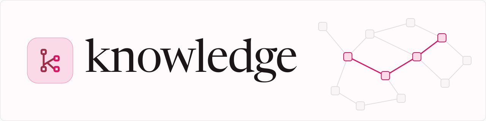
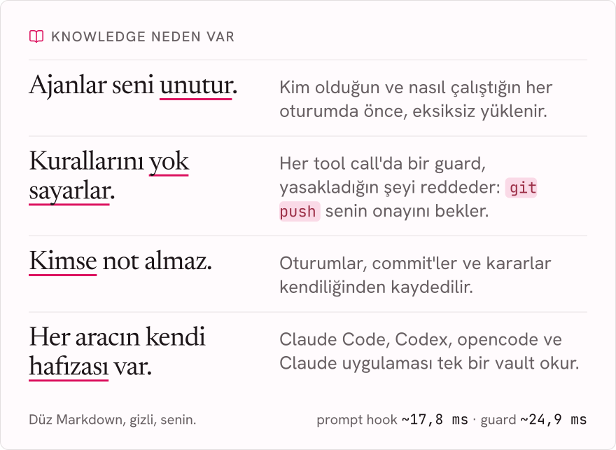

<p align="center">
  <picture>
    <source media="(prefers-color-scheme: dark)" srcset="../assets/banner-dark.svg">
    
  </picture>
</p>

<p align="center"><a href="../README.md">English</a> | <b>Türkçe</b> | <a href="README.es.md">Español</a> | <a href="README.pt.md">Português</a> | <a href="README.fr.md">Français</a> | <a href="README.de.md">Deutsch</a></p>

<p align="center">
  <a href="https://github.com/atlasatakahraman/knowledge/stargazers"><picture><source media="(prefers-color-scheme: dark)" srcset="https://raw.githubusercontent.com/atlasatakahraman/knowledge/badges/stars-tr-dark.svg"></picture></a>
  <a href="https://github.com/atlasatakahraman/knowledge/tags"><picture><source media="(prefers-color-scheme: dark)" srcset="https://raw.githubusercontent.com/atlasatakahraman/knowledge/badges/latest-tr-dark.svg"></picture></a>
</p>
<p align="center">
  <a href="#ajanlar"><picture><source media="(prefers-color-scheme: dark)" srcset="../assets/badges/harnesses-tr-dark.svg"></picture></a>
  <a href="#gereksinimler"><picture><source media="(prefers-color-scheme: dark)" srcset="../assets/badges/platforms-tr-dark.svg"></picture></a>
</p>
<p align="center">
  <a href="../docs/benchmark.md"><picture><source media="(prefers-color-scheme: dark)" srcset="../assets/badges/prompt-hook-tr-dark.svg"></picture></a>
  <a href="../docs/benchmark.md"><picture><source media="(prefers-color-scheme: dark)" srcset="../assets/badges/guard-tr-dark.svg"></picture></a>
  <a href="../docs/benchmark.md"><picture><source media="(prefers-color-scheme: dark)" srcset="../assets/badges/tokens-tr-dark.svg"></picture></a>
  <a href="../docs/benchmark.md"><picture><source media="(prefers-color-scheme: dark)" srcset="../assets/badges/find-tr-dark.svg"></picture></a>
</p>

<p align="center"><b>Seninle ve ajanlarınla birlikte büyüyen bilgi.</b><br>
Coding ajanları için hafıza ve kurallar. Kim olduğun, neyi yasakladığın ve neye karar
verdiğin, kullandığın her ajanın her oturumuna yüklenir.</p>

<picture>
  <source media="(prefers-color-scheme: dark)" srcset="../assets/hero-tr-dark.svg">
  
</picture>

## Hızlı başlangıç

### Ajanına yaptır

Bunu Claude Code, Codex ya da opencode'a yapıştır:

```text
Install knowledge for me from https://github.com/atlasatakahraman/knowledge.
Follow its AGENTS.md, show me each step's output, and ask before anything you write.
```

[AGENTS.md](../AGENTS.md) ajanı aşağıdaki adımların aynısından, her birinin basması gereken çıktıyla
geçirir. Sana setup planını gösterir, onu yalnızca senin onayınla uygular, sonra hangi kural
paketlerini istediğini sorar, kim olduğunu ve kurallarını seninle soru soru doldurur, vault için de
özel (private) bir GitHub repo'su önerir.

### Gereksinimler

`git`, `gitleaks`, Claude Code (`claude`) ve GitHub CLI (`gh`, build provenance için). Her
release'in platform başına imzalı bir arşivi var, açmadan önce doğrulanır
([docs/verify.md](../docs/verify.md)). Platformun için arşiv yoksa binary Rust toolchain
(`rustup`) ile kaynaktan, iki üç dakikada build edilir.

### Elle

```bash
git -c advice.detachedHead=false clone --branch v0.13.1 https://github.com/atlasatakahraman/knowledge ~/dev/knowledge
# the binary: your platform's release archive, verified, into ~/.local/bin (docs/install.md),
# or from source: cargo install --path ~/dev/knowledge --locked
knowledge setup --plan
knowledge setup --apply <id>      # the id is the plan's last line
```

`--plan` hiçbir şey yazmaz. Önce Claude Code için, sonra bulduğu diğer her ajan için oluşturacağı ya
da değiştireceği her dosyayı listeler ve planın id'siyle biter. `--apply <id>` o zamandan beri bir
şey değiştiyse reddeder, değişmediyse tam olarak o planı yazar. Yeni bir vault `~/knowledge` altına
kurulur; onun yerine var olan bir klasör de benimsenebilir. Flag'ler, Windows ve her adımın elle
yapılışı: [docs/install.md](../docs/install.md).

### Yeni bir vault'tan sonra

Onu kendine göre doldur. `00-Meta/Identity.md` ve `00-Meta/Hard-Rules.md` dosyalarını doldur
(`grep -rn "FILL:" ~/knowledge/00-Meta` kalanları listeler) ve `00-Meta/retrieval-cases.json`
içindeki soruları vault'un her zaman cevaplaması gereken sorularla değiştir. `knowledge doctor
--repair --pretty` ilk index'i kurar, `knowledge rules list` ile `rules enable <pack>` de istediğin
kural paketlerini açar.

## Pratikte bir oturum

[docs/benchmark.md](../docs/benchmark.md)'nin kullandığı public fixture'dan gerçek çıktı: vault olarak
bu repository'nin docs'u. Yollar kısaltıldı, uzun snippet'ler kesildi.

**Bir prompt yazarsın.** Prompt hook, ajan tek kelime okumadan önce onu cevaplayan notları ekler:

```text
> update knowledge to the newest release

Relevant notes from the knowledge vault (~/knowledge):
- **update** — $ knowledge update --plan  knowledge 0.13.1, x86_64-pc-windows-msvc …
- **verify** — …from `knowledge setup --plan`, or update.md over an older version. How a release …
- **release** — …A release is eight archives (build.yml's targets), one SHA256SUMS over them, …
```

**Ajan bir şeye bakar**, grep ve bir yığın okuma yerine, herhangi bir klasörden tek çağrıyla:

```text
$ knowledge find "check the signature on a downloaded release"
release — ~/knowledge/20-Knowledge/knowledge/release.md
  …download v0.13.1 -R atlasatakahraman/knowledge -p SHA256SUMS … 5. Check the signature…
verify — ~/knowledge/20-Knowledge/knowledge/verify.md
  …Three checks, each answering a different question: | The signature over SHA256SUMS | …
```

**Ajan, yasakladığın bir şeyi dener.** Guard, tool çalışmadan önce cevap verir:

```text
$ git reset --hard HEAD~3
ask: push-destructive-git (nothing-is-committed-until-i-give-an-explicit-go): each push needs
its own yes, and destructive git is the owner's call (Hard-Rules § Git)
```

**Oturum biter.** Günlük notu, commit'leri ve verdiği kararlar vault'a yazılır, diğer makinelerin
için de kendi remote'una push edilir.

## Ajanlar

"Doğrulandı", gerçek bir kurulumda canlı bir oturum demektir (Windows, 2026-11-23); aynı kontroller
Arch'ta kendi turunu bekliyor. Her adapter'ın kod yolu CI'da fixture kurulumlar üzerinde de çalışır.

| Ajan | Ne alır | Uygulama | Durum |
|---|---|---|---|
| Claude Code | `~/.claude/CLAUDE.md` içine bütün olarak import edilen Identity ve Hard-Rules; plugin'in dokuz event'teki hook'ları; `/knowledge`; kod haritası (`knowledge find --code`, `graph --code`) | `PreToolUse`'taki guard (shell, edit ve MCP çağrıları), deny ve ask ile; session-start restore; pre-commit backstop | Doğrulandı |
| Codex CLI | `~/.codex/AGENTS.md` içine bütün olarak yazılan blok; plugin'in sekiz event'teki hook'ları, binary'nin sürümüne sabitlenmiş; `~/.agents/skills` üzerinden `/knowledge`; MCP üzerinden `knowledge`, kod haritası dahil | `PreToolUse`'taki guard (`Bash`, `apply_patch`, MCP çağrıları), yalnızca deny: Codex soramadığı için bir ask kuralı deny olur; hook'lar ancak sen onları gözden geçirince çalışır; restore ve backstop | Doğrulandı |
| opencode | `~/.config/opencode/AGENTS.md` içindeki blok; sekiz event'te shim plugin, yedisi binary'yi çalıştırır; `/knowledge` | `execute.before` içindeki guard (`shell`, `edit`, `write`, `patch`), yalnızca deny; restore ve backstop | Doğrulandı; compaction ve session-delete event'leri yalnızca interaktif uygulamada çalışır ve onlara ulaşılmadı |
| Claude masaüstü uygulaması, Chat | `knowledge mcp`: `find`, `graph`, `read` ve yazmadan önce soran `note` | Yok: shell yok, hook yok, dolayısıyla korunacak bir tool çağrımız da yok | Doğrulandı |
| ChatGPT uygulamasının Codex'i | CLI'da güvenildikten sonra Codex plugin'inin hook'ları | Codex gibi; henüz güvenilmemiş hook'lar sessizce atlanır | Build edildi, doğrulanmadı |
| Diğer herhangi biri (`generic`) | Senin belirttiğin bir dosyadaki blok, `knowledge find` ve `graph`, geri yazmak için `knowledge note` | Çalışma anında yok: kurallar yalnızca metin. Pre-commit backstop yine de `setup`'ın kurduğu her clone'da çalışır | Build edildi, doğrulanmadı |

Bir ajanın nasıl eklendiği: [docs/architecture.md](../docs/architecture.md#harnesses).

## Nasıl çalışır

Tek bir native binary, `knowledge`, her hook'a cevap verir. Hiçbir hook bir JavaScript runtime'ı
başlatmaz ve vault'un index'i makine başına tek bir SQLite dosyasıdır.

- **Oturum başlangıcı** kim olduğunu ve kurallarını bütün olarak import eder, vault'u pull eder ve
  relock edilmeden değişen her kuralı geri koyar.
- **Her prompt** onu cevaplayan notların adlarını, en iyi pasajlarıyla birlikte alır (~17,8 ms).
- **Her tool çağrısı** önce guard'dan geçer (~24,9 ms): kuralın id'siyle `deny` ya da `ask`.
- **Oturum sonu** günlük notu, commit notlarını ve kararları yazar, sonra yalnızca bu kayıtları
  push eder.
- **İstek üzerine:** `knowledge find` (notlar, repo docs'u, yakalanan çıktı), `knowledge graph`
  (notların nasıl bağlandığı), `find --code` ve `graph --code` (bir sembolün nerede olduğu ve onu
  neyin kullandığı), `keep` ve `fetch` (uzun çıktı ve web sayfaları, saklanmış ve aranabilir).
- **`knowledge doctor`** hepsini tek seferde kontrol eder: index, vault'un her zaman cevaplaması
  gereken sorular, linkler, kayıtlar, kurallar. Oturum başında sessizlik, sağlıklı demektir.

Her hook'un ne yazdığı ve ne zaman: `template/00-Meta/Hook-Lifecycle.md`. Gerçek çıktısıyla her verb:
[docs/verbs.md](../docs/verbs.md).

### Kurallar ve guard

`00-Meta/Hard-Rules.md` tek not olarak kalır ve bütün olarak yüklenir. Her `##` bölümü bir pakettir.
Her kural kalın bir satırla açılan bir maddedir ve o satırın slug'ı kuralın id'sidir.
`00-Meta/rules.lock` (JSON, takip edilir) metnin tutamadığını tutar: her kuralın paketi, türü,
enforcement noktaları ve bütün metninin hash'i, bir de guard'lar. Prime edilen metne hiçbir şey
eklenmez. Notu düzenlersin, sonra `knowledge rules lock` çalıştırırsın ya da ajana çalıştırtırsın:
guard önce sana sorar.

- **Guard** (`hook pre-tool`, her ajanın shell, edit ve MCP çağrıları için pre-tool event'inde) bir
  shell satırını segmentlere ve kelimelere ayırır, kuralın id'siyle `deny` ya da `ask` cevabı verir.
  Yalnızca `rules.lock`'u okur. İzin verdiğinde hiçbir şey basmaz; lock eksik ya da bozuksa tek bir
  stderr satırıyla izin verir.
- **Backstop**, `githooks/pre-commit`'tir. Repo'nun kendi hook'unu, gitleaks'i, sonra
  `rules check --staged`'i çalıştırır; bu da bir guard'ın stage edilmiş adlarını
  (`package-lock.json`) içeren ya da lock'la uyuşmayan bir Hard-Rules taşıyan commit'i düşürür.
  `setup` onu vault'ta, skeleton'da ve bir `10-Repos` sayfasının adını verdiği her checkout'ta kurar.
- **Restore.** Her oturum başlangıcı `rules check --restore` çalıştırır. Lock'tan farklı bir kural,
  `HEAD` lock'la eşleşiyorsa `HEAD`'den geri gelir ve tek bir satır bunu söyler. Aksi halde sen
  relock ya da revert edene kadar doctor FAIL verir.

**Neyi durduramaz.** Senin adına kod çalıştıran bir ajan, senin değiştirebildiğin her dosyayı
değiştirebilir. Guard düz biçimleri sana sorar: bir Edit, `sed -i`, bir redirect, `Set-Content`.
Bir wrapper'ı (bir interpreter'ın `-e`'si, bir substitution, bir escape) yargılayamaz. O durum
sonradan, bir sonraki oturum başlangıcının restore'u ve doctor tarafından yakalanır.

## Neden bir hafıza dosyası değil

Bir hafıza dosyası, ajan onu okumayı unutana ya da başka bir klasöre ait kopyayı okuyana kadar
çalışır: Claude Code'un kendi hafızası çalışma dizinine göre bölünmüştür. Her ajan kendi hafızasını
tutar, bu yüzden Codex'in öğrendiği Claude Code'a hiç ulaşmaz. Bir dosyaya yazılmış kural da bir
tavsiyedir; onu çiğneyen tool çağrısını hiçbir şey durdurmaz.

Burada ajan hatırlasa da hatırlamasa da bir hook çalışır. Kuralların her ajanın her oturumunda bütün
olarak yüklenir, bir guard bir komutun çiğneyebileceği kuralları uygular ve kayıtları ajanın iyi
niyeti değil hook'lar yazar. Her parçanın bir gözcüsü var, çünkü böyle bir pipeline sessizleşerek
bozulur: `template/00-Meta/Why-This-Exists.md`.

## Verin ve ağ

- **Vault, kendi git repository'nde düz Markdown'dır.** Config'inin yanındaki, notlardan yaklaşık
  bir saniyede yeniden kurulan makine başına index'ler dışında hiçbir şey başka bir yerde saklanmaz.
- **Telemetri yok.** Hiçbir hook bizim bir sunucumuza bağlanmaz ve hiçbir şey kendi kendine
  güncelleme kontrol etmez.
- **Ağa ne dokunur:** `git pull` ve kayıtların push'u, vault'unun kendi remote'una; `fetch`, sen ya
  da ajan çalıştırdığında; `update --plan`, sen çalıştırdığında; headless flush ve compile, ajanının
  kendi CLI'ı ve hesabı üzerinden.
- **Asla okunmaz:** ajanların kimlik bilgileri. Engine ajanın CLI'ını çalıştırır ve oturum açmayı
  ona bırakır.

Tam liste ve `fetch`'in neyi reddettiği: [docs/security.md](../docs/security.md).

## Obsidian isteğe bağlı

Vault, `[[wikilinks]]` içeren bir Markdown dosyaları klasörüdür ve her verb Obsidian olmadan onun
üzerinde çalışır. Graph görünümünü istiyorsan Obsidian'da aç: `setup` gruplarını not türüne göre
renklendirir.

## Docs

İngilizce: [Kurulum](../docs/install.md) · [bir release'i doğrulama](../docs/verify.md) ·
[güncelleme](../docs/update.md) · [kaldırma](../docs/remove.md) · [her verb](../docs/verbs.md) ·
[güvenlik](../docs/security.md) · [sorun giderme](../docs/troubleshooting.md) ·
[benchmark](../docs/benchmark.md) · [mimari](../docs/architecture.md) · [release](../docs/release.md),
maintainer için.

## Katkıda bulunmak

Engine'in nasıl düzenlendiği, crate'leri, makine başına config, sync ve CI:
[docs/architecture.md](../docs/architecture.md). Bu repository üzerinde nasıl çalışılır:
[AGENTS.md](../AGENTS.md), ikinci kısım.

## Üçüncü taraf araçlar

Kendi upstream'lerinden kurulur, burada asla vendor edilmez:

- [gitleaks](https://github.com/gitleaks/gitleaks) - MIT. Her commit'i (`githooks/pre-commit`) ve
  kayıtları push edilmeden önce tarar. O olmadan hiçbir şey commit edilmez.

Görsellere çizilen fontlar (Newsreader, Hanken Grotesk, JetBrains Mono) SIL OFL 1.1, ikonlar
[Lucide](https://lucide.dev) (ISC).

## Lisans

MIT. Bkz. `LICENSE`. Yukarıdaki üçüncü taraf araçlar kendi lisanslarını korur.

0.4.0'a kadarki sürümler GPL-3.0-only altında yayımlandı ve onun altında erişilebilir kalır;
0.5.0'dan itibaren skeleton hiçbir GPL bağımlılığı almaz, böylece MIT izni bütün kalır.

---

Bu sayfa [README.md](../README.md)'nin çevirisidir; ikisi ayrılırsa İngilizce olan geçerlidir.
